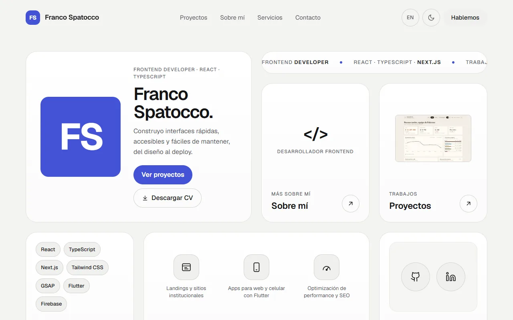

# Portfolio — Franco Spatocco

[](https://github.com/FranSpatocco/portfolio/actions/workflows/ci.yml)

Portfolio personal bilingüe (ES/EN) de un desarrollador frontend: proyectos con caso de estudio, servicios, CV descargable y formulario de contacto, en un diseño de tarjetas ("bento") con modo claro y oscuro.

**En vivo:** https://franco-spatocco.vercel.app

[](https://franco-spatocco.vercel.app)

## Qué incluye

- **Grilla bento** en la portada, con una cinta de texto animada en CSS puro (se frena con `prefers-reduced-motion`).
- **Casos de estudio** por proyecto (problema, decisiones y resultado), generados estáticos por idioma.
- **Español e inglés** con rutas `/es` y `/en`, `hreflang`, sitemap e imágenes para compartir por idioma.
- **Modo claro y oscuro** con tokens de color, igual de trabajados los dos.
- **CV en PDF** (ES/EN) generado desde los mismos datos del sitio.
- **Formulario de contacto** con Formspree, sin backend.
- **Accesibilidad y performance:** HTML semántico, contraste AA, foco visible, navegación por teclado; Lighthouse 90+ en mobile.
- **Seguridad:** cabeceras HTTP (CSP, X-Frame-Options y compañía) configuradas en `next.config.ts`.

## Stack

Next.js 16 (App Router, SSG) · React 19 · TypeScript · Tailwind CSS v4 · next-intl · GSAP · Formspree · Vercel

## Decisiones técnicas

- **Estático (SSG) y no dinámico:** el sitio no necesita datos en tiempo real; estático es más rápido, mejor para SEO y se hostea gratis. Lo dinámico se muestra en los proyectos.
- **Textos separados de los datos:** `src/data/projects.ts` guarda solo lo que no se traduce (stack, links, imagen) y los textos viven en `messages/*.json`. Sumar un proyecto es una entrada en cada archivo.
- **Modo oscuro sin parpadeo:** un script mínimo en el `<head>` aplica el tema antes del primer paint; el botón no necesita estado de React.
- **CV generado desde código:** el contenido vive en `cv/cv-data.mjs` (ES/EN) y se imprime a PDF, así el CV y el sitio nunca quedan desfasados.
- **Un solo gesto visual por diseño:** el esfuerzo va a la ejecución (espaciados, foco, mobile, modo claro y oscuro), no a los efectos.

> Desarrollado con Claude Code como asistente de programación. Las decisiones de producto, diseño y arquitectura son mías y quedaron registradas en el momento en `bitacora.txt`.

## Desarrollo

```bash
npm install
cp .env.example .env.local   # opcional
npm run dev                  # http://localhost:3000
```

| Script | Qué hace |
| --- | --- |
| `npm run dev` | Servidor de desarrollo |
| `npm run build` | Build de producción (todas las rutas estáticas) |
| `npm run lint` | ESLint |
| `npm run typecheck` | Genera los tipos de rutas de Next y corre TypeScript |
| `npm run og` | Genera las imágenes para compartir (`public/og/`) |
| `npm run cv` | Genera el CV en PDF (`public/cv/`) |

Contexto del proyecto y convenciones: `CLAUDE.md`. Requisitos: `PRD-portfolio.md`. Registro técnico: `bitacora.txt`.
