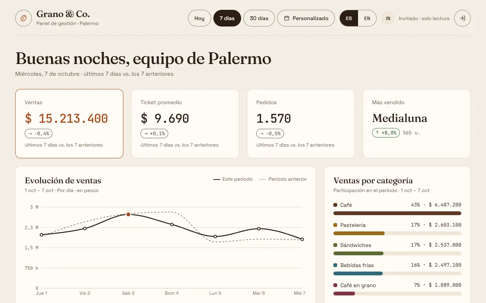
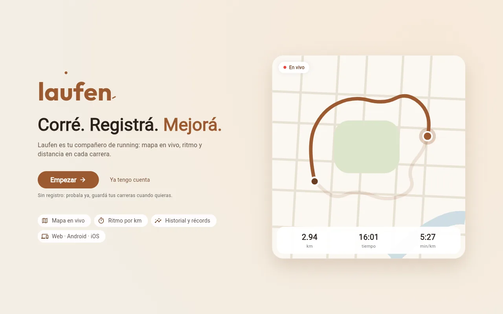
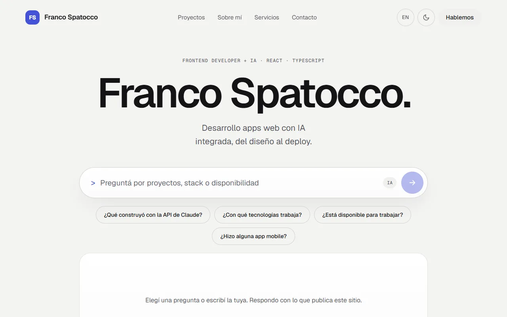

# Hola, soy Franco 👋

**Frontend Developer + IA · React · TypeScript · Next.js · Flutter**

Analista de Sistemas. Desarrollo apps web con IA integrada, del diseño al deploy: paneles y sitios con Next.js y la API de Claude, y apps para web y celular con Flutter. Hoy estoy sumando Python y RAG.

📬 **Estoy buscando trabajo y estoy disponible**: remoto, desde Argentina, en relación de dependencia o como freelance.

_Front-end developer + AI (React, TypeScript, Next.js, Flutter). I build web apps with integrated AI, from design to deploy. Looking for work and available now: remote, from Argentina, full-time or freelance._

**Stack:** React · TypeScript · Next.js · Tailwind CSS · GSAP · Flutter · Dart · Firebase · Vercel · API de Claude

## Proyectos

<table>
  <tr>
    <td colspan="2">
      
      <h3>Grano &amp; Co. · dashboard con IA</h3>
      Panel de gestión de una cafetería (ficticia, datos simulados): ventas, pedidos y stock en una pantalla, con un resumen semanal escrito por la API de Claude. 
      Next.js · TypeScript · Firebase · TanStack Query · Recharts · API de Claude 
      <a href="https://grano-co-dashboard.vercel.app"><b>Ver demo</b></a> · <a href="https://github.com/FranSpatocco/grano-co-dashboard">Código</a>
    </td>
  </tr>
  <tr>
    <td width="50%" valign="top">
      
      <h3>Laufen · app de running</h3>
      GPS, mapa en vivo, parciales por km e intervalos. Android y web con un mismo código. 
      Flutter · Dart · Firebase 
      <a href="https://laufen-app.web.app"><b>Ver demo</b></a> · <a href="https://github.com/FranSpatocco/laufen">Código</a>
    </td>
    <td width="50%" valign="top">
      
      <h3>Portfolio</h3>
      Bilingüe (ES/EN), con animaciones y diseño de tarjetas. Lighthouse 90+ en mobile. 
      Next.js · TypeScript · Tailwind CSS · next-intl · GSAP 
      <a href="https://franco-spatocco.vercel.app"><b>Ver sitio</b></a> · <a href="https://github.com/FranSpatocco/portfolio">Código</a>
    </td>
  </tr>
</table>

## Sobre mí

También curso la Tecnicatura en Mantenimiento Industrial: me interesa el cruce entre software, automatización e Industria 4.0.

## Contacto

[Portfolio](https://franco-spatocco.vercel.app) · [LinkedIn](https://www.linkedin.com/in/franco-spatocco/) · fspatocco02@gmail.com
